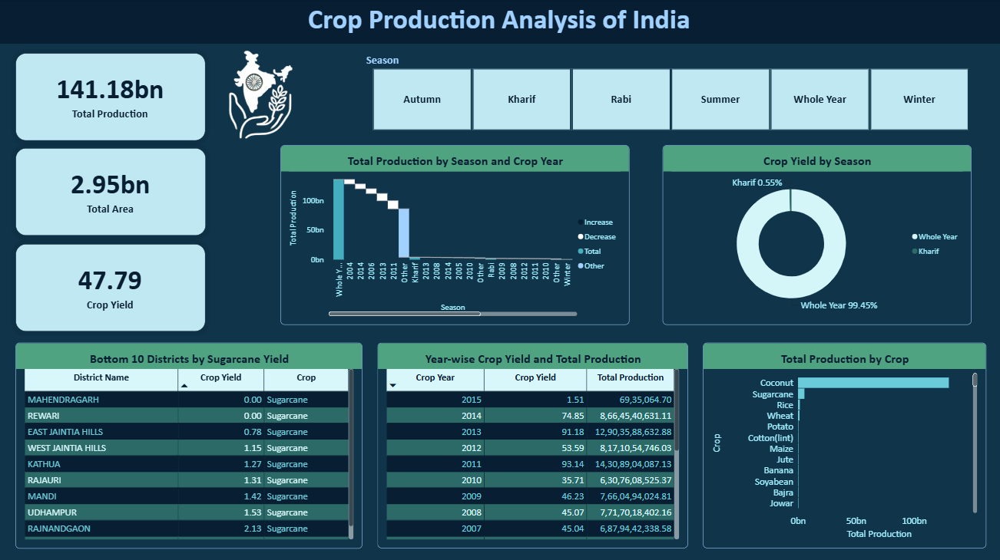
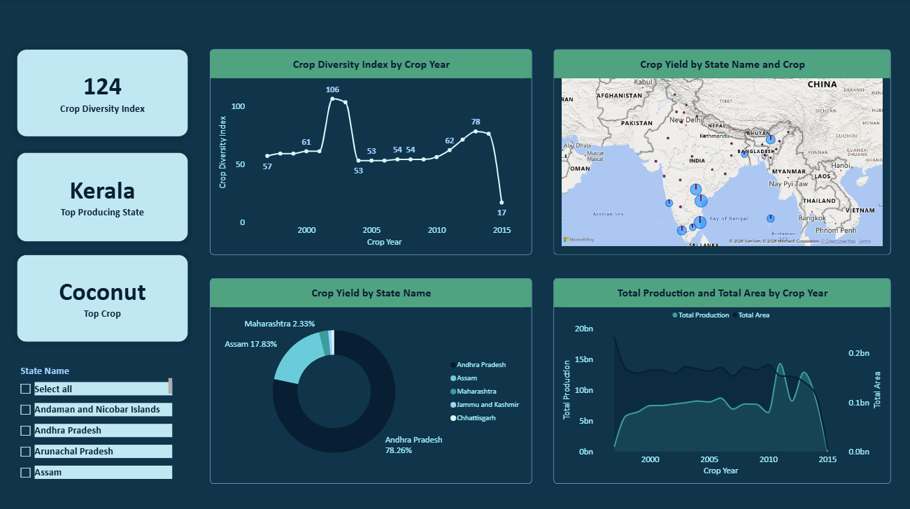

# 🌾 Crop Production Analysis of India

## Overview

This project is a 2-page interactive reporting dashboard in Power BI that analyzes 2.4 lakh+ crop records across 33 states, 646 districts, and 124 crops from 1997 to 2015. The analysis explores production trends, seasonal contribution, geographic distribution, crop diversity, and production efficiency to derive meaningful insights from Indian agricultural data.

## Dashboard Preview

### Overview and Insights

### Detailed Analysis

## Features & Visualizations

### 1. Overview and Insights

- Cards - Display KPIs such as Total Production, Total Area, and Crop Yield.
- Waterfall chart - Analyzes total production by season and crop year.
- Donut chart - Explores seasonal contribution to crop yield.
- Tables - Display bottom 10 districts by sugarcane yield, and year-wise crop yield and total production.
- Stacked bar chart - Compares each crop's contribution to total production.
- Slicer - Filters the data by season.

### 2. Detailed Analysis

- Cards - Display KPIs such as Crop Diversity Index, Top Producing State, and Top Crop.
- Line chart - Explores crop diversity index by crop year.
- Donut chart - Compares crop yield by state.
- Area chart - Analyzes total production and total area by crop year.
- Map - Displays crop yield by state and crop.
- Slicer - Filters the data by state.

## Key Insights

- Andhra Pradesh was identified as the highest-yielding state, with coconut contributing substantially to its yield.
- Whole Year crops accounted for the majority of crop yield.
- 2015 recorded the lowest crop diversity index among the years analyzed.
- Crop yield and production patterns varied considerably across states, districts, seasons, and crops.

## Dataset

The dataset contains crop production records with the following fields:
- State
- District
- Crop Year
- Season
- Crop
- Area
- Production

## Tools & Technologies

- Microsoft Power BI
- Power Query - ETL
- DAX - Measures and KPI calculations
- Microsoft Excel - Source dataset

## Skills Demonstrated

- Data Cleaning
- Data Transformation
- Data Visualization
- Dashboard Design
- Business Intelligence
- KPI Reporting
- DAX Measures
- Power Query
